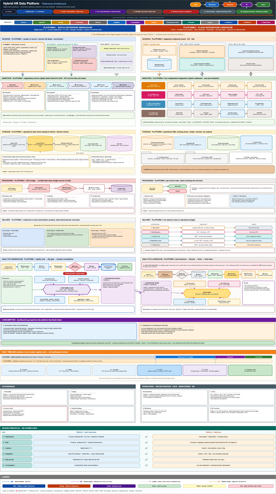

# Hybrid HR Data Platform Reference Architecture

## Overview

This repository contains a generic reference architecture for a hybrid enterprise HR data platform.

The design demonstrates how a traditional batch-oriented SQL Server data warehouse and a modern Azure Databricks lakehouse can coexist in one analytics ecosystem.

The architecture combines:

- Batch enterprise warehouse patterns
- Operational data stores
- ETL orchestration
- Azure Databricks lakehouse patterns
- Medallion Architecture
- Lakehouse Federation
- Power BI and Databricks SQL consumption
- Data quality, governance, CI/CD, monitoring, and recovery patterns

This is a sanitized portfolio artifact created to demonstrate enterprise data platform architecture thinking. It is not client documentation and does not include proprietary data, production code, credentials, internal system names, or real employee/customer data.

---

## Architecture Diagram

The diagram shows a side-by-side hybrid architecture:

- **Platform 1:** Batch enterprise warehouse using SQL Server, ETL orchestration, curated data stores, Kimball modeling, and Power BI.
- **Platform 2:** Cloud lakehouse using Azure Databricks, Delta Lake, Medallion Architecture, event/API/file integrations, and operational analytics.
- **Federation seam:** Lakehouse Federation enables Databricks to reuse enterprise conformed dimensions without copying data into the lakehouse.

---

## What This Demonstrates

- Hybrid data platform architecture
- Batch warehouse and lakehouse coexistence
- Enterprise HR data integration
- Operational data stores
- Kimball dimensional modeling
- Medallion Architecture
- Lakehouse Federation
- Power BI and Databricks SQL consumption
- Data quality and reconciliation patterns
- Security and governance controls
- CI/CD, monitoring, and recovery patterns
- Platform modernization thinking

---

## Platform 1: Batch Enterprise Warehouse

Platform 1 represents the traditional enterprise warehouse architecture.

Typical characteristics:

- Nightly batch processing
- SQL Server operational data stores
- ETL orchestration
- Curated enterprise data store
- Kimball dimensional warehouse
- Conformed dimensions
- Fact and aggregate tables
- Power BI enterprise dashboards
- Schema-level security and row-level security
- Blocking DQ gates before publish

This platform is best suited for:

- Enterprise workforce analytics
- Historical reporting
- Conformed KPI definitions
- Broad BI consumption
- Highly governed and sensitive datasets

---

## Platform 2: Cloud Lakehouse

Platform 2 represents the cloud lakehouse extension.

Typical characteristics:

- Event-driven and scheduled micro-batch processing
- Azure Databricks
- Delta Lake
- Bronze / Silver / Gold layers
- Integration-specific dimensional models
- Shared DQ logging
- Databricks SQL operational dashboards
- Power BI dashboards over Gold views
- Lakehouse Federation to reuse conformed dimensions

This platform is best suited for:

- Integration analytics
- Operational monitoring
- Event-driven use cases
- Near-real-time visibility
- Lightweight domain-specific Gold models
- Reduced data replication

---

## Federation Pattern

Lakehouse Federation is the seam between the two platforms.

The design principle is:

> Keep conformed enterprise dimensions in the warehouse and let the lakehouse query them live when needed.

This avoids:

- Duplicate dimension copies
- Synchronization lag
- Reconciliation overhead
- Conflicting worker or organization context
- Unnecessary data movement

Federation is best used for:

- Worker identity
- Organization context
- Date and job dimensions
- Lookup enrichment
- Reusable semantic views

---

## Consumption Layer

The reference architecture supports multiple consumption patterns:

### Power BI over Enterprise Warehouse

Used for:

- Large business audiences
- Governed enterprise dashboards
- RLS
- Composite models
- Aggregation-backed dashboards
- Daily reporting cycles

### Power BI over Databricks Gold Views

Used for:

- Business-facing lakehouse analytics
- Scheduled refresh
- Import mode
- Semantic-ready Gold reporting views
- Minimal DAX when business logic is pre-modeled

### Databricks SQL Dashboards

Used for:

- Operational monitoring
- Small technical audiences
- Live SQL execution
- Near-real-time visibility
- No imported BI dataset

---

## Governance and Operations

The design includes cross-cutting governance and operations patterns:

- Data quality checks
- Blocking vs alerting DQ strategies
- Audit logging
- Source-to-target lineage
- Schema registry
- Access control
- Row-level security
- CI/CD promotion
- Job monitoring
- Alerting and incident management
- Backup, recovery, and replay patterns

---

## Design Principles

1. Keep enterprise conformed dimensions in the system of record.
2. Use federation instead of replication where live conformed context is sufficient.
3. Use batch warehouse patterns for enterprise-grade historical analytics.
4. Use lakehouse patterns for integration-specific analytics and operational monitoring.
5. Apply Medallion Architecture only where it adds analytical value.
6. Keep facts local to where the data originates.
7. Use Power BI for broad business consumption.
8. Use Databricks SQL for operational lakehouse monitoring.
9. Treat DQ and reconciliation as architecture capabilities.
10. Design security and governance into every layer.

---

## Confidentiality Note

This repository contains only sanitized, generic architecture artifacts created for portfolio purposes. It does not include proprietary client documentation, confidential data, production code, credentials, internal system names, or real employee/customer data.

---

## Author

**Sri Adilakshmi Marrivada**  
Lead Consultant | Data Platform Architect | 19+ Years Experience  
[LinkedIn Profile](https://www.linkedin.com/in/sri-adilakshmi-marrivada)
