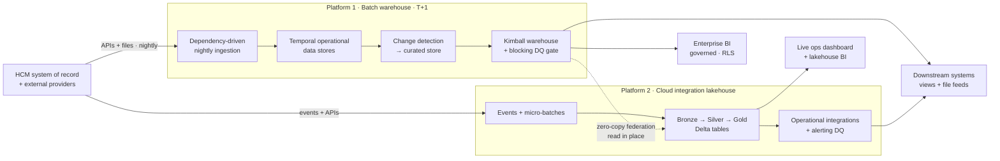

# Hybrid HR Data Platform: Reference Architecture

### Nightly Batch Warehouse + Event-Driven Cloud Lakehouse, Joined by Zero-Copy Federation

> **About:** A generalized reference architecture for organizations that run an established
> nightly data warehouse alongside a newer cloud lakehouse. It describes common enterprise
> patterns, the decisions behind them, and how the platform behaves when things fail.
> Products shown (SQL Server, Informatica, Azure Databricks, Power BI) are examples; the patterns apply
> to equivalent technologies. This is **not** documentation of any specific organization's
> system and contains no proprietary names, data, code or configurations.

**Related:** For a 4-phase modernization roadmap with a hands-on implementation, see
[Enterprise-Data-Platform-Evolution-Reference-Architecture](https://github.com/srimarrivada/Enterprise-Data-Platform-Evolution-Reference-Architecture).

---

## The Problem This Pattern Addresses

Many enterprises have a trusted nightly warehouse that is complete, reconciled and governed, with
data available T+1. They also have a growing need for near-real-time integrations such as onboarding events, recruiting
sync, learning-platform exchange, and operational monitoring of all of them.

- **Replacing the warehouse** is risky, since security, reconciliation and sensitive-data handling
  would all need re-certifying at once.
- **Extending the warehouse** with near-real-time loads competes with the nightly batch window.
- **Copying warehouse data** into a second platform creates two versions of the truth.

This pattern keeps each platform doing what it does best and connects them **without copying data**.

## At a Glance

### Detailed Diagram

🔗 **[Open the interactive diagram](https://viewer.diagrams.net/?nav=1&layers=1#Uhttps://raw.githubusercontent.com/srimarrivada/Hybrid-HR-Data-Platform-Reference-Architecture/main/docs/diagrams/source/hybrid-hr-platform-reference-architecture.drawio)**: toggle layers, hover the gold **D1–D13** markers for trade-offs, and click through to each decision record.

<b>Show detailed diagram</b>

## Two Platforms, Two Roles

| Axis | Platform 1: Batch Warehouse | Platform 2: Integration Lakehouse |
|---|---|---|
| Example stack | Relational database (e.g., SQL Server) + ETL tool (e.g., Informatica, SSIS) + enterprise scheduler (e.g., TWS, Control-M) | Cloud lakehouse (e.g., Azure Databricks, Delta Lake, Unity Catalog) |
| Role | **Producer** of enterprise conformed dimensions and history | **Consumer and integrator** for specific use cases |
| Cadence | Nightly, T+1 | Events and micro-batches |
| Data quality | **Blocking** gate before publish | **Alerting** checks + reconciliation |
| Sensitive data | Holds restricted data in tiered schemas | Restricted data stays out |
| Consumption | Governed enterprise BI with row-level security | Live operational dashboard + imported business dashboards |
| Strong at | Governance, history, conformed context, broad BI | Fast integration analytics, monitoring, replay |
| Weak at | Near-real-time and event-driven use cases | Being a second enterprise warehouse (it shouldn't be) |

## Key Patterns

1. **Dependency-tiered nightly batch:** Jobs start when their predecessors finish, not on a clock, so independent work runs in parallel.
2. **Temporal ODS family:** Separate current, effective-dated, future-dated, history and full stores, so back-dated and future-dated changes are handled correctly.
3. **Content-based change detection:** Set-based compare or row hash, excluding volatile columns, with history kept rather than overwritten (SCD2).
4. **Kimball constellation with a publish gate:** Conformed dimensions shared across subject areas, published only when quality checks pass.
5. **Idempotent loads:** Every load is safe to re-run, and state advances only on success.
6. **Medallion lakehouse applied selectively:** Bronze captures transient sources; an integration gets a Gold layer only when it has real analytical value.
7. **Zero-copy federation:** The lakehouse reads conformed dimensions in place through a few governed views, with keys resolved at ETL time.
8. **Consumption by audience:** Composite governed BI for the broad audience, live SQL for operations, imported dashboards for lakehouse business users.
9. **Defense-in-depth security:** Schema tiers, row-level security, data minimization, and no restricted data through federation.

## Architecture Decisions

Each decision has an [Architecture Decision Record](docs/adr/README.md) covering its context, alternatives, consequences, guardrails, and the signals for revisiting it. The numbers match the gold markers on the diagram.

| # | Decision | Chosen over |
|---|---|---|
| [D1](docs/adr/0001-two-platforms-not-one.md) | Two platforms, not one | Big-bang migration; near-real-time loads in the warehouse |
| [D2](docs/adr/0002-temporal-ods-family.md) | Temporal ODS family | Single SCD2 staging table; snapshots only |
| [D3](docs/adr/0003-dependency-tiered-batch.md) | Dependency-tiered batch | Fixed clock schedule; single sequential chain |
| [D4](docs/adr/0004-federation-over-replication.md) | Federation over replication | Nightly dimension copies; CDC streams |
| [D5](docs/adr/0005-blocking-vs-alerting-dq.md) | Blocking vs alerting DQ | One DQ mode everywhere |
| [D6](docs/adr/0006-bi-tool-by-audience.md) | BI tool and refresh mode by audience | One tool and refresh mode for all |
| [D7](docs/adr/0007-selective-medallion.md) | Medallion only where it adds value | Medallion for every integration |
| [D8](docs/adr/0008-change-detection-strategy.md) | Change detection by content compare | Source timestamps; full reloads |
| [D9](docs/adr/0009-idempotent-loads.md) | Idempotent loads, safe re-runs | Manual cleanup; truncate-and-reload |
| [D10](docs/adr/0010-kimball-dimensional-model.md) | Kimball dimensional model | 3NF; Data Vault; raw views |
| [D11](docs/adr/0011-defense-in-depth-security.md) | Defense-in-depth security | Row-level security only |
| [D12](docs/adr/0012-bronze-captures-transient-sources.md) | Bronze captures transient source data | Process-and-forward with no capture |
| [D13](docs/adr/0013-fact-design-patterns.md) | Fact and dimension design patterns | One fact per source; unweighted bridges |

## When Things Fail

The platform is designed so that a failure never causes silent data loss, a partial publish, or double counting. See [Failure Modes](docs/failure-modes.md) for detection, automatic behavior, and recovery steps.

| # | Failure | Designed outcome |
|---|---|---|
| [F1](docs/failure-modes.md#f1-nightly-run-fails-part-way) | Nightly run fails part-way | Same window re-extracted; resume from the failed step |
| [F2](docs/failure-modes.md#f2-data-quality-gate-below-threshold) | DQ gate below threshold | Previous warehouse version stays live |
| [F3](docs/failure-modes.md#f3-integration-record-or-api-call-fails) | Integration record or API call fails | Record marked failed; retry or replay from Bronze |
| [F4](docs/failure-modes.md#f4-federation-slow-or-enterprise-warehouse-unavailable) | Federation slow or enterprise warehouse unavailable | Last good Gold served; keys reconciled later |
| [F5](docs/failure-modes.md#f5-late-or-back-dated-source-changes) | Late or back-dated source changes | Corrections merged; history corrected, not overwritten |

## Documentation

Read in this order, the way a design review would go:

1. **Context**
   - [Business Context](docs/business-context.md)
   - [Non-Functional Requirements](docs/nfrs.md)
   - [Source Assessment](docs/source-assessment.md)
2. **Architecture**
   - [Architecture Overview](docs/architecture/architecture-overview.md)
   - [Platform 1: Batch Enterprise Warehouse](docs/architecture/platform-1-batch-warehouse.md)
   - [Platform 2: Cloud Lakehouse](docs/architecture/platform-2-lakehouse.md)
   - [Federation Pattern](docs/architecture/federation-pattern.md)
   - [Consumption Pattern](docs/architecture/consumption-pattern.md)
   - [Governance and Operations](docs/architecture/governance-and-operations.md)
3. **Decisions**
   - [Design Principles](docs/design-principles.md)
   - [ADR Index](docs/adr/README.md)
4. **Operating It**
   - [Failure Modes](docs/failure-modes.md)
   - [Risks and Mitigations](docs/risks.md)

## Where This Goes Next

This pattern is a stable middle state, not an end state. The signals for moving on are recorded in each ADR's *Revisit When* section: most consumers needing sub-day freshness, the warehouse nearing end of support, or lakehouse governance becoming mature enough to hold restricted data. The [Evolution repo](https://github.com/srimarrivada/Enterprise-Data-Platform-Evolution-Reference-Architecture) shows one path toward a single governed lakehouse.

## Confidentiality Note

This repository contains generalized architecture patterns created for portfolio purposes. It contains no proprietary documentation, client or system names, real data, production code, configurations, schedules, or volumes.

## License

Licensed under the [MIT License](LICENSE).

## Author

**Sri Adilakshmi Marrivada**: Data Platform Architect | 19+ years 
Enterprise data architecture, cloud data platforms, data engineering and governance 
[LinkedIn](https://www.linkedin.com/in/sri-adilakshmi-marrivada/)
